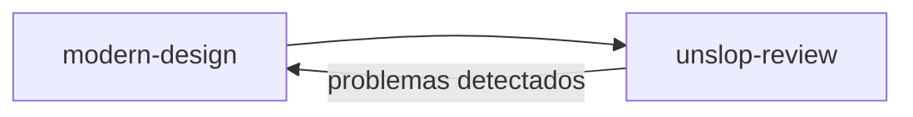

<p align="center"></p>

<p align="center">Un plugin de Claude Code para que cualquier persona, sepa o no de diseño, consiga interfaces modernas, adaptadas a su proyecto, que no parezcan hechas con IA y basadas en referencias reales de internet.</p>

<p align="center">
  <a href="LICENSE"></a>
  
  
</p>

<p align="center"><a href="README.md">English</a> · <b>Español</b></p>

> **En desarrollo inicial.** Esto es un esqueleto. Las dos skills existen, pero son plantillas vacías, y todavía no se ha probado con proyectos reales. Si lo instalas hoy, Claude Code verá los nombres de las skills y poco más. Consulta el [Roadmap](docs/ROADMAP.md).

## Tabla de contenidos

- [Sobre el proyecto](#sobre-el-proyecto)
- [Funcionalidades](#funcionalidades)
- [Instalación](#instalación)
- [Cómo funciona](#cómo-funciona)
- [Skills](#skills)
- [Estructura del proyecto](#estructura-del-proyecto)
- [Limitaciones conocidas](#limitaciones-conocidas)
- [Créditos](#créditos)
- [Licencia](#licencia)
- [Contacto](#contacto)

## Sobre el proyecto

Hay demasiados recursos de diseño: librerías de componentes, packs de skills, galerías, webs de fuentes, kits de animación, listas para quitar el "aspecto IA" en redes sociales. Para una diseñadora o un diseñador es una caja de herramientas. Para alguien que no lo es, es fricción: no sabes cuál usar, cuándo ni cómo encajan, y acabas con la misma landing con degradado morado que todo el mundo.

Este plugin ordena esos recursos y los aplica con criterio. Primero pregunta por el producto y el público, mira webs reales como referencia y después pasa por tokens, componentes, animación y revisión en un orden fijo. Las reglas dependen del contexto: un patrón que es un cliché en un producto puede ser la decisión correcta en otro.

## Funcionalidades

Previstas. Nada de esto funciona todavía.

- **Primero el contexto:** un brief breve (producto, público, tono, stack) que siguen todos los pasos posteriores.
- **Referencias en vivo:** busca en internet webs comparables y extrae sus principios, sin clonarlas.
- **Tokens de diseño:** paleta, combinación tipográfica, espaciado, radios, sombras, temas claro y oscuro.
- **Componentes de fuentes contrastadas:** secciones y componentes adaptados al brief y al stack del proyecto.
- **Animación con propósito:** tiempos, curvas y microinteracciones, y saber cuándo no animar.
- **Revisión anti-slop:** detecta los patrones genéricos de las webs hechas con IA antes de entregar.
- **QA visual:** capturas en un navegador real a tres anchos, más contraste, foco, desbordamientos y estados vacíos.
- **Activación bilingüe:** las skills responden a peticiones en inglés y en español.

## Instalación

Necesitas [Claude Code](https://code.claude.com). En una sesión de Claude Code:

```text
/plugin marketplace add santiagodie/modern-design-pack
/plugin install modern-design-pack@santiagodie-plugins
```

Para ofrecerlo a todo el equipo de un proyecto, añade esto al `.claude/settings.json` del proyecto:

```json
{
  "extraKnownMarketplaces": {
    "santiagodie-plugins": {
      "source": { "source": "github", "repo": "santiagodie/modern-design-pack" }
    }
  },
  "enabledPlugins": {
    "modern-design-pack@santiagodie-plugins": true
  }
}
```

Cada persona acepta el aviso de confianza del espacio de trabajo e instala el plugin una vez por clon, por ejemplo con `claude plugin install modern-design-pack@santiagodie-plugins --scope project`.

Las skills se activan solas a partir de su descripción, o se pueden llamar directamente, por ejemplo `/modern-design-pack:modern-design`.

## Cómo funciona

Dos skills: una construye y la otra revisa.



`modern-design` trabaja en cinco pasos: dirección, tokens, componentes, animación y paso a `unslop-review`. Cada paso carga su propio archivo de referencia solo cuando hace falta, así que una petición sobre colores no carga las pautas de animación.

**El contexto manda sobre las reglas.** Las reglas se escriben como "haz X cuando Y", no como prohibiciones absolutas. El brief del paso de dirección decide cuándo se aplica cada una.

**Referencias, no copias.** El paso de dirección usa WebSearch para encontrar webs comparables, WebFetch para leerlas y capturas con Playwright para verlas. Anota los principios de cada referencia, nunca su código, recursos ni textos.

Más detalle en [docs/ARCHITECTURE.md](docs/ARCHITECTURE.md) (en inglés).

## Skills

| Skill | Para qué sirve |
|---|---|
| `modern-design` | Punto de entrada para diseñar o rediseñar. Reúne contexto y referencias en vivo y después define dirección, tokens (color, tipografía, espaciado), componentes y animación para el proyecto. |
| `unslop-review` | Detecta y corrige patrones genéricos de IA y errores habituales de UI, con revisión en un navegador real y capturas a anchos de móvil, tablet y escritorio. |

## Estructura del proyecto

```text
modern-design-pack/
├── .claude-plugin/
│   ├── plugin.json          # manifiesto del plugin
│   └── marketplace.json     # marketplace "santiagodie-plugins", apunta a este repo como "./"
├── skills/
│   ├── modern-design/
│   │   ├── SKILL.md
│   │   └── references/      # direction, tokens, components, motion, resources
│   └── unslop-review/
│       ├── SKILL.md
│       └── references/      # visual-qa
├── assets/banner.svg
├── docs/
│   ├── SOURCES.md           # todas las fuentes externas y el estado de su licencia
│   ├── ARCHITECTURE.md      # flujo entre skills y principios
│   └── ROADMAP.md
├── .claude/CLAUDE.md        # convenciones para trabajar en este repo
├── README.md / README.es.md
├── CHANGELOG.md
├── LICENSE
└── THIRD_PARTY_NOTICES.md
```

## Limitaciones conocidas

- **Skills vacías:** cada `SKILL.md` es una plantilla con secciones TODO. El plugin todavía no hace nada útil.
- **Sin probar:** ningún proyecto real ha pasado por el flujo. No está comprobado que las skills se activen en inglés y en español.
- **Licencias sin auditar:** la licencia de cada fuente de `docs/SOURCES.md` sigue en `TO VERIFY`. Cada una se revisa cuando se vaya a usar. No se ha copiado nada de terceros.
- **Fuentes sin identificar:** dos de las listas anti-slop vienen de capturas cuyo autor aún no está identificado.
- **Depende de un navegador:** la revisión en navegador de `unslop-review` y la parte de capturas del paso de dirección necesitarán Playwright, que el plugin no instala.
- **Sin icono:** el plugin aún no tiene icono para el listado.

## Créditos

Este plugin ordena ideas de muchas personas del diseño y de proyectos de código abierto. La lista completa está en [docs/SOURCES.md](docs/SOURCES.md), y todo lo que se adapte se acreditará con su licencia en [THIRD_PARTY_NOTICES.md](THIRD_PARTY_NOTICES.md).

- [ui-ux-pro-max-skill](https://github.com/nextlevelbuilder/ui-ux-pro-max-skill): complemento opcional recomendado. Aporta un gran catálogo de estilos, paletas y combinaciones tipográficas que encaja bien junto a este plugin.

## Licencia

Publicado bajo la [licencia MIT](LICENSE). El material de terceros conserva su propia licencia, indicada en [THIRD_PARTY_NOTICES.md](THIRD_PARTY_NOTICES.md).

## Contacto

Santiago Die · [GitHub](https://github.com/santiagodie) · [LinkedIn](https://www.linkedin.com/in/santiago-die-morejon)
