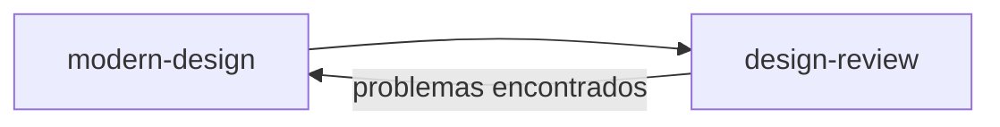

<p align="center"></p>

<p align="center">Un plugin de Claude Code que ayuda a cualquiera, sepa o no de diseño, a conseguir interfaces modernas, adaptadas a su proyecto, que no parezcan hechas con IA y basadas en referencias reales de la web.</p>

<p align="center">
  <a href="LICENSE"></a>
  
  
  <a href="https://github.com/santiagodie/modern-design-pack/actions/workflows/skill-checks.yml"></a>
</p>

<p align="center"><a href="README.md">English</a> · <b>Español</b></p>

> **En desarrollo inicial (v0.1.0, aún sin publicar).** Las dos skills funcionan, pero apenas se han probado, y la guía de animación todavía no está escrita. Consulta las [limitaciones conocidas](#limitaciones-conocidas) y el [Roadmap](docs/ROADMAP.md) (en inglés).

## Tabla de contenidos

- [Qué es](#qué-es)
- [Qué funciona hoy](#qué-funciona-hoy)
- [Requisitos](#requisitos)
- [Instalación](#instalación)
- [Cómo trabaja](#cómo-trabaja)
- [Principios](#principios)
- [Estructura del proyecto](#estructura-del-proyecto)
- [Limitaciones conocidas](#limitaciones-conocidas)
- [Créditos](#créditos)
- [Licencia](#licencia)
- [Contacto](#contacto)

## Qué es

Hay demasiados recursos de diseño: librerías de componentes, paquetes de skills, galerías, webs de fuentes, kits de animación, listas "anti-slop" en redes sociales. Para quien diseña son una caja de herramientas. Para quien no, son un obstáculo: no sabes cuál usar, cuándo ni cómo encajan, y acabas con la misma landing de degradado morado que todo el mundo.

Este plugin ordena esos recursos y los aplica con criterio. Primero pregunta por el producto y el público, busca webs reales como referencia y después recorre tokens, secciones y revisión en un orden fijo.

El objetivo son cinco skills que comparten un mismo método de revisión:

| Skill | Estado | Para qué sirve |
|---|---|---|
| `modern-design` | Disponible | Diseñar o rediseñar una web, una landing, una pantalla de app o un flujo: dirección, tokens, secciones, animación |
| `design-review` | Disponible | Revisar cualquier interfaz: tu propio proyecto (revisión, comprobación en navegador, correcciones) o una URL pública (auditoría de solo lectura con informe) |
| `accessibility-review` | Planificada | Revisión de accesibilidad más allá de lo que se ve en las capturas |
| `seo-geo-optimizer` | Planificada | Visibilidad en buscadores y en respuestas de IA |
| `content-web-optimizer` | Planificada | Textos y contenido de la página |

Qué no es: una librería de componentes, un generador de plantillas ni un constructor de páginas. No escribe el contenido de tu negocio (ver [Principios](#principios)) y no revisa la seguridad del backend; te avisa cuando un proyecto necesita esa revisión.

## Qué funciona hoy

`modern-design`:

- **Dirección:** reúne el contexto (producto, público, tono, stack), busca de tres a cinco webs reales comparables y escribe un brief de diseño con una dirección decidida y una promesa central.
- **Razonamiento por página:** doce guías por tipo de página (entrada y marketing, comercio, cuenta, legal, soporte y otras), cada una con el momento del usuario, la duda principal que la página debe resolver y cuándo se invierte el consejo habitual.
- **Tokens:** color (con tema oscuro), tipografía y espaciado, con tokens de foco, tamaño de objetivo táctil y movimiento reducido.
- **Secciones:** ocho tipos de sección para páginas que persuaden (cabecera, hero, llamada a la acción, prueba social, beneficios, formularios, llamada final, pie), cada una con su diseño para móvil, tableta y escritorio.
- **Implementación:** renderizado por ruta, estado, rendimiento, accesibilidad y el mínimo legal.
- **Animación:** sin escribir todavía; el modelo sigue el brief con su propio criterio.

`design-review`:

- **Proyecto propio:** revisa el código con listas de patrones genéricos de IA y errores de interfaz, comprueba la página en un navegador real, corrige lo local y escribe notas de revisión.
- **Auditoría de URL:** revisión de solo lectura de hasta tres páginas públicas, guardada como informe con problemas críticos, problemas menores, patrones anticuados, consejos y propuestas. Cada hallazgo indica si se midió o es una valoración.
- **Comprobación en navegador:** capturas a 375, 768, 1024 y 1440 px (1920 solo cuando líneas o rejillas llegan de borde a borde), táctil emulado en las tres primeras, movimiento reducido activado, scripts de página para desbordes, tamaño de objetivos, metaetiquetas y señales móviles, un recorrido de foco con teclado y Lighthouse si hay Chrome.

## Requisitos

- **Imprescindible:** [Claude Code](https://code.claude.com). El plugin no necesita ningún otro plugin ni skill.
- **Para la comprobación en navegador de `design-review` y las capturas de referencia de `modern-design`:** Node.js (LTS) con npm.
  - `@playwright/cli` 0.1.25, instalado de forma global con npm después de que la skill te lo pregunte. Descarga su propio navegador la primera vez.
  - `serve` 14.2.8, ejecutado con `npx`, solo para webs estáticas sin servidor de desarrollo.
- **Para las puntuaciones de Lighthouse:** Google Chrome. Lighthouse 13.6.0 se ejecuta con `npx`.
- **Acceso a la red:** para las descargas de `npx` y del navegador, y para WebSearch y WebFetch en el paso de dirección.

Qué pasa si falta algo:

- **Sin Node.js:** `design-review` lo dice una vez y hace una revisión de criterio del código o del HTML; cada medición queda como "not measured".
- **Sin Chrome:** el informe dice que Lighthouse no se ejecutó y no da puntuaciones.
- **Sin navegador en el paso de dirección:** las páginas de referencia se leen con WebFetch y el brief indica que se omitió la comparación visual.
- **`PRODUCT.md` y `DESIGN.md` de Impeccable:** se leen solo si ya existen en tu proyecto; el plugin nunca los escribe.

## Instalación

Desde GitHub, en una sesión de Claude Code:

```text
/plugin marketplace add santiagodie/modern-design-pack
/plugin install modern-design-pack@santiagodie-plugins
```

Para ofrecerlo a todo el equipo de un proyecto, añade esto al `.claude/settings.json` del proyecto:

```json
{
  "extraKnownMarketplaces": {
    "santiagodie-plugins": {
      "source": { "source": "github", "repo": "santiagodie/modern-design-pack" }
    }
  },
  "enabledPlugins": {
    "modern-design-pack@santiagodie-plugins": true
  }
}
```

Cada persona acepta el aviso de confianza del espacio de trabajo e instala el plugin una vez por clon, por ejemplo con `claude plugin install modern-design-pack@santiagodie-plugins --scope project`.

Para desarrollo en local, clona el repositorio y arranca Claude Code con el plugin cargado para esa sesión:

```bash
claude --plugin-dir ./modern-design-pack
```

Ejecuta `/reload-plugins` después de editar sus archivos.

Las skills se activan solas a partir de su descripción, o se pueden llamar directamente: `/modern-design-pack:modern-design`, o `/modern-design-pack:design-review https://example.com` para auditar una web.

## Cómo trabaja



- **Pasos de `modern-design`:** dirección, tokens, componentes (secciones), animación y paso a `design-review`. Cada paso carga solo sus propios archivos de referencia.
- **Primero el hero:** en una web o página nueva, se construye primero solo el hero de la página principal. `design-review` lo revisa, y el resto se construye cuando estás de acuerdo con la dirección.
- **Tres subagentes:**
  - `design-explorer` (Haiku) localiza texto en tu proyecto y en las listas del plugin;
  - `design-writer` (Sonnet) construye a partir del plan;
  - `design-reviewer` (Sonnet) mide y escribe el informe en un contexto limpio, sin corregir nada.

  Tu sesión principal planifica, decide y te pregunta; usa el modelo más capaz que tengas. Sin la herramienta Agent, todo se hace en la sesión principal en el mismo orden.
- **Dos modos de `design-review`:** proyecto propio (revisión, comprobación en navegador, corrección, notas de revisión) y auditoría de URL (solo lectura, solo páginas públicas, tres como máximo).
- **Revisión de rediseños:** antes de cambiar una página que ya existe, `design-review` anota a dónde enlaza, qué envía y qué anuncia. Después del cambio compara; lo que se haya perdido bloquea la entrega, salvo que lo quitaras a propósito.
- **Niveles:** cada hallazgo es **Floor** (no se publica con él: corrección, acceso, honestidad), **Reflex** (un hábito en el que cae un modelo, aceptable con un motivo propio de la página) o **Finish** (detalle de oficio, nunca bloquea).

Más detalle en [docs/ARCHITECTURE.md](docs/ARCHITECTURE.md) (en inglés).

**Archivos del proyecto.** `modern-design` escribe en la raíz de tu proyecto: `design-brief.md` (la dirección), `site-decisions.md` (los estándares de tu código, el inventario de lo que existe y tus propias decisiones) y `content-needed.md` (lo que aún tienes que aportar). `design-review` escribe `review-notes.md` en tu proyecto, y las auditorías de URL van a `audits/`.

## Principios

- **Nada inventado.** Nunca se inventan precios, cifras, textos del negocio, reseñas, horarios, direcciones, datos legales ni fotos. El contenido que falta se convierte en un marcador visible, anotado en `content-needed.md`, y `design-review` bloquea la publicación mientras quede alguno.
- **Decides tú, salvo en ética.** Tus decisiones en `site-decisions.md` están por encima del brief y de las listas de comprobación. Por encima de ellas solo están los límites firmes: no inventar contenido y no usar patrones engañosos.
- **Razonar antes que recorrer listas.** Cada página parte de lo que duda su visitante y de lo que debe demostrar. Las reglas se escriben como "haz X cuando Y", y un patrón que es un tópico para un producto puede ser lo correcto para otro.
- **Referencias, no copias.** Las webs reales aportan principios, nunca código, recursos ni textos.

## Estructura del proyecto

```text
modern-design-pack/
├── .claude-plugin/
│   ├── plugin.json          # manifiesto del plugin
│   └── marketplace.json     # marketplace "santiagodie-plugins", lista este repo como "./"
├── .github/workflows/
│   └── skill-checks.yml     # comprobaciones de NVIDIA SkillEvaluator en cada push y PR
├── agents/                  # design-explorer, design-writer, design-reviewer
├── skills/
│   ├── modern-design/
│   │   ├── SKILL.md
│   │   └── references/
│   │       ├── reasoning.md, evidence.md, ethics.md, content-truth.md, resources.md
│   │       ├── strategy/    # dirección, razonamiento de diseño, principios, ejemplos
│   │       ├── ux/pages/    # doce guías por tipo de página
│   │       ├── ui/          # tokens (color, oscuro, tipografía, espaciado), animación, sections/
│   │       ├── engineering/ # implementación, responsive
│   │       └── templates/   # site-decisions, content-needed
│   └── design-review/
│       ├── SKILL.md
│       ├── references/      # método de revisión, listas, revisión visual, rediseños, formato del informe
│       └── scripts/         # scripts de página y la comparación de inventarios
├── assets/banner.svg
├── docs/
│   ├── ARCHITECTURE.md      # flujo de skills, agentes, niveles, árbol de referencias
│   ├── ROADMAP.md
│   ├── SOURCES.md           # todas las fuentes externas, con el estado de su licencia
│   ├── examples/            # informes y capturas de las pruebas
│   └── research/            # investigación en la que se basan las referencias
├── .claude/CLAUDE.md        # convenciones para trabajar en este repo
├── README.md / README.es.md
├── CHANGELOG.md
├── LICENSE
└── THIRD_PARTY_NOTICES.md
```

## Limitaciones conocidas

- **La animación no está escrita:** el paso de animación es un esqueleto; el modelo sigue el brief con su propio criterio, con los nombres de tokens de animación que reserva el paso de tokens.
- **Faltan las secciones de páginas que operan:** paneles, tablas y pantallas de administración tienen guía de página, pero aún no tienen archivos de sección. Tampoco están escritos los componentes reutilizables (botones, tarjetas, campos).
- **Poco probado:** `design-review` se ha probado en unas pocas webs públicas y páginas generadas, y la regla de no inventar en dos reconstrucciones ([resultados](docs/examples/), en inglés). Sin probar todavía: el paso de tokens, que `site-decisions.md` anule una regla, los subagentes y la revisión del hero primero, y la activación con peticiones naturales en inglés y en español. Las valoraciones y las métricas de laboratorio varían entre ejecuciones.
- **Búsqueda de referencias:** en las pruebas no interactivas el navegador no pudo abrir webs externas; falta repetirla en una sesión interactiva.
- **Auditoría de licencias parcial:** la licencia de cada fuente se comprueba cuando se va a usar; las filas que siguen marcadas `TO VERIFY` en `docs/SOURCES.md` aún no se han comprobado. No se ha copiado texto de terceros, salvo citas breves acreditadas.
- **Fuentes sin identificar:** algunas listas anti-slop vienen de capturas cuyos autores aún no se han identificado; se acreditan como tales.
- **Sin icono:** el plugin aún no tiene icono para el listado.

## Créditos

Este plugin ordena ideas de muchas personas del diseño y de proyectos de código abierto. Todas las fuentes están en [docs/SOURCES.md](docs/SOURCES.md), y el material adaptado se acredita con su licencia en [THIRD_PARTY_NOTICES.md](THIRD_PARTY_NOTICES.md).

Complementos opcionales (no hacen falta para usar este plugin):

- [Impeccable](https://impeccable.style), de Paul Bakaus: comandos de diseño y muchas comprobaciones automáticas de antipatrones. Se solapa con `design-review`, que resume algunas de sus ideas con palabras propias pero no replica sus comprobaciones.
- [Modern Web Guidance](https://developer.chrome.com/docs/modern-web-guidance), de Chrome for Developers: una skill para agentes con guías sobre las funciones nativas de la plataforma web y los fallos que cometen los agentes. La referencia de implementación de `modern-design` guarda una lista breve y remite a ella.
- [ui-ux-pro-max-skill](https://github.com/nextlevelbuilder/ui-ux-pro-max-skill): un gran catálogo de estilos, paletas y combinaciones tipográficas.

## Licencia

Publicado bajo la [licencia MIT](LICENSE). El material de terceros conserva su propia licencia, indicada en [THIRD_PARTY_NOTICES.md](THIRD_PARTY_NOTICES.md).

## Contacto

Santiago Die · [GitHub](https://github.com/santiagodie) · [LinkedIn](https://www.linkedin.com/in/santiago-die-morejon)
