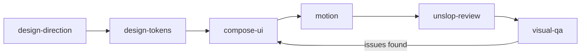

<p align="center"></p>

<p align="center">A Claude Code plugin that helps anyone, designer or not, get modern interfaces that fit their project, don't look AI-made, and are informed by live references from the web.</p>

<p align="center">
  <a href="LICENSE"></a>
  
  
</p>

<p align="center"><b>English</b> · <a href="README.es.md">Español</a></p>

> **Early development.** This is a skeleton. The six skills exist but are empty templates, and nothing has been tested on real projects yet. Installing it today adds the skill names to Claude Code and little else. See the [Roadmap](docs/ROADMAP.md).

## Table of Contents

- [About the Project](#about-the-project)
- [Features](#features)
- [Installation](#installation)
- [How It Works](#how-it-works)
- [Skills](#skills)
- [Project Structure](#project-structure)
- [Known Limitations](#known-limitations)
- [Credits](#credits)
- [License](#license)
- [Contact](#contact)

## About the Project

There are too many design resources: component libraries, skill packs, galleries, font sites, animation kits, "unslop" checklists on social media. For a designer that is a toolbox. For someone who isn't a designer it is friction: you don't know which one to use, when, or how they fit together, so you end up with the same purple-gradient landing page as everyone else.

This plugin puts those resources in order and applies them with judgement. It asks about the product and the audience first, looks at real sites on the web for reference, and then works through tokens, components, motion and review in a fixed sequence. Rules depend on context: a pattern that is a cliché for one product can be the right call for another.

## Features

Planned. None of this works yet.

- **Context first:** a short brief (product, audience, tone, stack) that every later step follows.
- **Live references:** searches the web for comparable sites and extracts principles from them, without cloning.
- **Design tokens:** palette, type pairing, spacing, radii, shadows, light and dark themes.
- **Components from proven sources:** sections and components adapted to the brief and the project's stack.
- **Purposeful motion:** timing, easing and micro-interactions, and knowing when not to animate.
- **Anti-slop review:** catches generic AI-made patterns before delivery.
- **Visual QA:** real-browser screenshots at three widths, plus contrast, focus, overflow and empty states.
- **Bilingual triggers:** skills respond to requests in English and Spanish.

## Installation

Requires [Claude Code](https://code.claude.com). In a Claude Code session:

```text
/plugin marketplace add santiagodie/modern-design-pack
/plugin install modern-design-pack@santiagodie-plugins
```

To offer it to everyone working on a project, add this to the project's `.claude/settings.json`:

```json
{
  "extraKnownMarketplaces": {
    "santiagodie-plugins": {
      "source": { "source": "github", "repo": "santiagodie/modern-design-pack" }
    }
  },
  "enabledPlugins": {
    "modern-design-pack@santiagodie-plugins": true
  }
}
```

Each contributor accepts the workspace trust prompt and installs the plugin once per clone, for example with `claude plugin install modern-design-pack@santiagodie-plugins --scope project`.

Skills trigger on their own from the description, or can be called directly, for example `/modern-design-pack:design-direction`.

## How It Works



**Context over rules.** Rules are written as "do X when Y", not as absolute bans. The brief from `design-direction` decides when a rule applies.

**References, not copies.** `design-direction` uses WebSearch to find comparable sites, WebFetch to read them, and Playwright screenshots to see them. It records the principles behind each reference and never its code, assets or copy.

More detail in [docs/ARCHITECTURE.md](docs/ARCHITECTURE.md).

## Skills

| Skill | What it is for |
|---|---|
| `design-direction` | Starting point. Gathers context, researches live references, writes the design brief. |
| `design-tokens` | Color palette, type pairing, spacing, radii, shadows, light and dark themes. |
| `compose-ui` | Builds sections and components (hero, features, pricing, nav, forms, backgrounds). |
| `motion` | Animation and interaction: timing, easing, micro-interactions, scroll, text. |
| `unslop-review` | Finds and fixes generic AI-made patterns and common UI mistakes. |
| `visual-qa` | Checks the running UI in a real browser at mobile, tablet and desktop widths. |

## Project Structure

```text
modern-design-pack/
├── .claude-plugin/
│   ├── plugin.json          # plugin manifest
│   └── marketplace.json     # marketplace "santiagodie-plugins", lists this repo as "./"
├── skills/
│   ├── design-direction/    # SKILL.md + references/
│   ├── design-tokens/
│   ├── compose-ui/
│   ├── motion/
│   ├── unslop-review/
│   └── visual-qa/
├── assets/banner.svg
├── docs/
│   ├── SOURCES.md           # every external source, with licence status
│   ├── ARCHITECTURE.md      # skill flow and principles
│   └── ROADMAP.md
├── .claude/CLAUDE.md        # conventions for working on this repo
├── README.md / README.es.md
├── CHANGELOG.md
├── LICENSE
└── THIRD_PARTY_NOTICES.md
```

## Known Limitations

- **Empty skills:** every `SKILL.md` is a template with TODO sections. The plugin does nothing useful yet.
- **Untested:** no real project has been through the flow. Skill triggering in English and Spanish is unverified.
- **Licences unaudited:** the licence of every source in `docs/SOURCES.md` is still `TO VERIFY`. Nothing third-party has been copied in.
- **Unidentified sources:** two of the anti-slop lists come from screenshots whose authors are not yet identified.
- **Browser dependency:** `visual-qa` and the screenshot part of `design-direction` will need Playwright, which is not set up by the plugin.
- **No icon:** the plugin has no listing icon yet.

## Credits

This plugin organises ideas from many designers and open-source projects. The full list is in [docs/SOURCES.md](docs/SOURCES.md), and anything adapted will be credited with its licence in [THIRD_PARTY_NOTICES.md](THIRD_PARTY_NOTICES.md).

- [ui-ux-pro-max-skill](https://github.com/nextlevelbuilder/ui-ux-pro-max-skill): recommended as an optional companion. It brings a large searchable catalogue of styles, palettes and font pairings that fits alongside this plugin.

## License

Released under the [MIT License](LICENSE). Third-party material keeps its own licence, listed in [THIRD_PARTY_NOTICES.md](THIRD_PARTY_NOTICES.md).

## Contact

Santiago Die · [GitHub](https://github.com/santiagodie) · [LinkedIn](https://www.linkedin.com/in/santiago-die-morejon)
