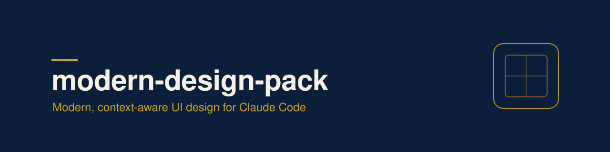
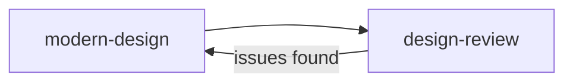

<p align="center"></p>

<p align="center">A Claude Code plugin that helps anyone, designer or not, get modern interfaces that fit their project, don't look AI-made, and are informed by live references from the web.</p>

<p align="center">
  <a href="LICENSE"></a>
  
  
  <a href="https://github.com/santiagodie/modern-design-pack/actions/workflows/skill-checks.yml"></a>
</p>

<p align="center"><b>English</b> · <a href="README.es.md">Español</a></p>

> **Early development (v0.1.0, not released yet).** Both skills work, but they are lightly tested, and motion guidance is not written yet. See [Known Limitations](#known-limitations) and the [Roadmap](docs/ROADMAP.md).

## Table of Contents

- [What It Is](#what-it-is)
- [What Works Today](#what-works-today)
- [Requirements](#requirements)
- [Installation](#installation)
- [How It Works](#how-it-works)
- [Principles](#principles)
- [Project Structure](#project-structure)
- [Known Limitations](#known-limitations)
- [Credits](#credits)
- [License](#license)
- [Contact](#contact)

## What It Is

There are too many design resources: component libraries, skill packs, galleries, font sites, animation kits, "unslop" checklists on social media. For a designer that is a toolbox. For someone who isn't a designer it is friction: you don't know which one to use, when, or how they fit together, so you end up with the same purple-gradient landing page as everyone else.

This plugin puts those resources in order and applies them with judgment. It asks about the product and the audience first, looks at real sites for reference, and then works through tokens, sections and review in a fixed order.

The goal is five skills that share one review method:

| Skill | Status | What it is for |
|---|---|---|
| `modern-design` | Available | Designing or redesigning a site, a landing page, an app screen or a flow: direction, tokens, sections, motion |
| `design-review` | Available | Reviewing any interface: your own project (review, browser check, fixes) or a public URL (read-only audit with a report) |
| `accessibility-review` | Planned | Accessibility review beyond what is visible in screenshots |
| `seo-geo-optimizer` | Planned | Search and AI-answer visibility |
| `content-web-optimizer` | Planned | Page copy and content |

What it is not: a component library, a template generator or a page builder. It doesn't write your business content (see [Principles](#principles)), and it doesn't review backend security; it tells you when a project needs that review.

## What Works Today

`modern-design`:

- **Direction:** gathers context (product, audience, tone, stack), finds three to five comparable live sites, and writes a design brief with one committed direction and a central promise.
- **Page reasoning:** twelve page-type guides (entry and marketing, commerce, account, legal, support and others), each with the user's moment, the main doubt the page must answer and when the usual advice flips.
- **Tokens:** color (including a dark theme), typography and spacing, with focus, target size and reduced-motion tokens.
- **Sections:** eight section types for pages that persuade (header, hero, call to action, social proof, benefits, forms, final call to action, footer), each with phone, tablet and desktop layouts.
- **Implementation:** rendering per route, state, performance, accessibility and the legal minimum.
- **Motion:** not written yet; the model follows the brief with its own judgment.

`design-review`:

- **Own project:** reviews the code against checklists of generic AI-made patterns and UI mistakes, checks the page in a real browser, fixes local issues and writes review notes.
- **URL audit:** a read-only review of up to three public pages, saved as a report with critical issues, minor issues, outdated patterns, tips and proposals. Every finding says whether it was measured or is a judgment call.
- **Browser check:** screenshots at 375, 768, 1024 and 1440 px (1920 only when lines or grids run edge to edge), touch emulated at the first three, reduced motion on, page scripts for overflow, target size, meta tags and mobile signals, a keyboard focus pass, and Lighthouse when Chrome is available.

## Requirements

- **Required:** [Claude Code](https://code.claude.com). The plugin needs no other plugin or skill.
- **For the browser check in `design-review` and the reference screenshots in `modern-design`:** Node.js (LTS) with npm.
  - `@playwright/cli` 0.1.25, installed globally with npm after the skill asks you. It downloads its own browser on first use.
  - `serve` 14.2.8, run through `npx`, only for static sites without a dev server.
- **For Lighthouse scores:** Google Chrome. Lighthouse 13.6.0 runs through `npx`.
- **Network access:** for the `npx` and browser downloads, and for WebSearch and WebFetch in the direction step.

What happens when something is missing:

- **No Node.js:** `design-review` says so once and does a judgment review of the code or the HTML; every measurement is recorded as "not measured".
- **No Chrome:** the report says Lighthouse didn't run and gives no scores.
- **No browser in the direction step:** reference pages are read with WebFetch, and the brief says the visual comparison was skipped.
- **Impeccable's `PRODUCT.md` and `DESIGN.md`:** read only when they already exist in your project; the plugin never writes them.

## Installation

From GitHub, in a Claude Code session:

```text
/plugin marketplace add santiagodie/modern-design-pack
/plugin install modern-design-pack@santiagodie-plugins
```

To offer it to everyone working on a project, add this to the project's `.claude/settings.json`:

```json
{
  "extraKnownMarketplaces": {
    "santiagodie-plugins": {
      "source": { "source": "github", "repo": "santiagodie/modern-design-pack" }
    }
  },
  "enabledPlugins": {
    "modern-design-pack@santiagodie-plugins": true
  }
}
```

Each contributor accepts the workspace trust prompt and installs the plugin once per clone, for example with `claude plugin install modern-design-pack@santiagodie-plugins --scope project`.

For local development, clone the repository and start Claude Code with the plugin loaded for that session:

```bash
claude --plugin-dir ./modern-design-pack
```

Run `/reload-plugins` after editing its files.

Skills trigger on their own from their description, or can be called directly: `/modern-design-pack:modern-design`, or `/modern-design-pack:design-review https://example.com` to audit a site.

## How It Works



- **`modern-design` steps:** direction, tokens, components (sections), motion, then hand-off to `design-review`. Each step loads only its own reference files.
- **Hero first:** on a new site or page, only the hero of the main page is built first. `design-review` checks it, and the rest is built once you agree with the direction.
- **Three subagents:**
  - `design-explorer` (Haiku) locates text in your project and in the plugin's lists;
  - `design-writer` (Sonnet) builds from the plan;
  - `design-reviewer` (Sonnet) measures and writes the report in a clean context, and fixes nothing.

  Your main session plans, decides and asks you questions; use the most capable model you have. Without the Agent tool, everything runs in the main session in the same order.
- **Two `design-review` modes:** own project (review, browser check, fix, review notes) and URL audit (read-only, public pages only, three at most).
- **Redesign check:** before an existing page changes, `design-review` records what it links to, submits and announces. After the change it compares; anything lost blocks delivery unless you removed it on purpose.
- **Levels:** every finding is **Floor** (never ships: correctness, access, honesty), **Reflex** (a habit a model falls into, acceptable with a reason specific to the page) or **Finish** (craft detail, never blocks).

Details in [docs/ARCHITECTURE.md](docs/ARCHITECTURE.md).

**Project files.** `modern-design` writes in your project root: `design-brief.md` (the direction), `site-decisions.md` (the standards in your code, an inventory of what exists, and your own decisions) and `content-needed.md` (what you still need to supply). `design-review` writes `review-notes.md` in your project, and URL audits go to `audits/`.

## Principles

- **Nothing invented.** Prices, figures, business texts, reviews, hours, addresses, legal details and photos are never made up. Missing content becomes a visibly marked placeholder, listed in `content-needed.md`, and `design-review` blocks publishing while any remain.
- **You decide, except on ethics.** Your decisions in `site-decisions.md` rank above the brief and above the checklists. The only things above them are the hard limits: no invented content and no deceptive patterns.
- **Reasoning over checklists.** Each page starts from what its visitor doubts and what it must prove. Rules are written as "do X when Y", and a pattern that is a cliché for one product can be the right call for another.
- **References, not copies.** Live sites inform principles, never code, assets or copy.

## Project Structure

```text
modern-design-pack/
├── .claude-plugin/
│   ├── plugin.json          # plugin manifest
│   └── marketplace.json     # marketplace "santiagodie-plugins", lists this repo as "./"
├── .github/workflows/
│   └── skill-checks.yml     # NVIDIA SkillEvaluator checks on every push and PR
├── agents/                  # design-explorer, design-writer, design-reviewer
├── skills/
│   ├── modern-design/
│   │   ├── SKILL.md
│   │   └── references/
│   │       ├── reasoning.md, evidence.md, ethics.md, content-truth.md, resources.md
│   │       ├── strategy/    # direction, design reasoning, principles, examples
│   │       ├── ux/pages/    # twelve page-type guides
│   │       ├── ui/          # tokens (color, dark, type, space), motion, sections/
│   │       ├── engineering/ # implementation, responsive
│   │       └── templates/   # site-decisions, content-needed
│   └── design-review/
│       ├── SKILL.md
│       ├── references/      # review method, checklists, visual QA, regression check, report format
│       └── scripts/         # page scripts and the inventory comparison
├── assets/banner.svg
├── docs/
│   ├── ARCHITECTURE.md      # skill flow, agents, levels, reference tree
│   ├── ROADMAP.md
│   ├── SOURCES.md           # every external source, with licence status
│   ├── examples/            # test reports and screenshots
│   └── research/            # research behind the references
├── .claude/CLAUDE.md        # conventions for working on this repo
├── README.md / README.es.md
├── CHANGELOG.md
├── LICENSE
└── THIRD_PARTY_NOTICES.md
```

## Known Limitations

- **Motion is not written:** the motion step is a skeleton; the model follows the brief with its own judgment, using the motion token names the tokens step reserves.
- **Sections for pages that operate are missing:** dashboards, tables and admin screens have page guides but no section files yet. Reusable components (buttons, cards, inputs) are not written either.
- **Lightly tested:** `design-review` was tested on a few public sites and generated pages, and the no-invention rule in two rebuilds ([results](docs/examples/)). Not tested yet: the tokens step, `site-decisions.md` overriding a rule, the subagents and the hero-first review, and triggering from natural requests in English and Spanish. Judgment calls and lab metrics vary between runs.
- **Reference research:** in non-interactive tests the browser couldn't open external sites; an interactive re-test is pending.
- **Partial licence audit:** each source's licence is checked when it is about to be used; rows still marked `TO VERIFY` in `docs/SOURCES.md` are not checked yet. No third-party text has been copied beyond short credited quotes.
- **Unidentified sources:** some anti-slop lists come from screenshots whose authors are not yet identified; they are credited as such.
- **No icon:** the plugin has no listing icon yet.

## Credits

This plugin organises ideas from many designers and open-source projects. Every source is listed in [docs/SOURCES.md](docs/SOURCES.md), and adapted material is credited with its licence in [THIRD_PARTY_NOTICES.md](THIRD_PARTY_NOTICES.md).

Optional companions (not needed to use this plugin):

- [Impeccable](https://impeccable.style) by Paul Bakaus: design commands and many automated anti-pattern checks. It overlaps with `design-review`, which summarises some of its ideas in its own words but doesn't replicate its checks.
- [Modern Web Guidance](https://developer.chrome.com/docs/modern-web-guidance) by Chrome for Developers: an agent skill with guides on native web platform features and the mistakes agents make. `modern-design`'s implementation reference keeps a short checklist and points to it.
- [ui-ux-pro-max-skill](https://github.com/nextlevelbuilder/ui-ux-pro-max-skill): a large searchable catalogue of styles, palettes and font pairings.

## License

Released under the [MIT License](LICENSE). Third-party material keeps its own licence, listed in [THIRD_PARTY_NOTICES.md](THIRD_PARTY_NOTICES.md).

## Contact

Santiago Die · [GitHub](https://github.com/santiagodie) · [LinkedIn](https://www.linkedin.com/in/santiago-die-morejon)
