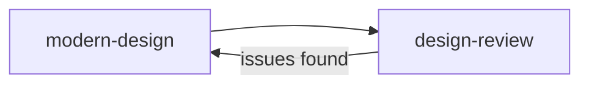

<p align="center"></p>

<p align="center">A Claude Code plugin that helps anyone, designer or not, get modern interfaces that fit their project, don't look AI-made, and are informed by live references from the web.</p>

<p align="center">
  <a href="LICENSE"></a>
  
  
</p>

<p align="center"><b>English</b> · <a href="README.es.md">Español</a></p>

> **Early development.** `design-review` is written and has been through a first round of tests ([results](docs/examples/phase-2-results.md)). `modern-design` has its first step (direction and design brief) written and tested ([results](docs/examples/phase-3/phase-3-results.md)); its tokens, components and motion steps are still empty. See the [Roadmap](docs/ROADMAP.md).

## Table of Contents

- [About the Project](#about-the-project)
- [Features](#features)
- [Installation](#installation)
- [How It Works](#how-it-works)
- [Skills](#skills)
- [Project Structure](#project-structure)
- [Known Limitations](#known-limitations)
- [Credits](#credits)
- [License](#license)
- [Contact](#contact)

## About the Project

There are too many design resources: component libraries, skill packs, galleries, font sites, animation kits, "unslop" checklists on social media. For a designer that is a toolbox. For someone who isn't a designer it is friction: you don't know which one to use, when, or how they fit together, so you end up with the same purple-gradient landing page as everyone else.

This plugin puts those resources in order and applies them with judgement. It asks about the product and the audience first, looks at real sites on the web for reference, and then works through tokens, components, motion and review in a fixed sequence. Rules depend on context: a pattern that is a cliché for one product can be the right call for another.

## Features

Planned. None of this works yet.

- **Context first:** a short brief (product, audience, tone, stack) that every later step follows.
- **Live references:** searches the web for comparable sites and extracts principles from them, without cloning.
- **Design tokens:** palette, type pairing, spacing, radii, shadows, light and dark themes.
- **Components from proven sources:** sections and components adapted to the brief and the project's stack.
- **Purposeful motion:** timing, easing and micro-interactions, and knowing when not to animate.
- **Anti-slop review:** catches generic AI-made patterns before delivery.
- **Visual QA:** real-browser screenshots at three widths, plus contrast, focus, overflow and empty states.
- **Audit any URL:** a read-only review of any public site, returned as a report with critical issues, minor issues, outdated patterns, tips, proposals and alternatives. Each finding says whether it was measured or is design judgment.
- **Bilingual triggers:** skills respond to requests in English and Spanish.

## Installation

Requires [Claude Code](https://code.claude.com). In a Claude Code session:

```text
/plugin marketplace add santiagodie/modern-design-pack
/plugin install modern-design-pack@santiagodie-plugins
```

To offer it to everyone working on a project, add this to the project's `.claude/settings.json`:

```json
{
  "extraKnownMarketplaces": {
    "santiagodie-plugins": {
      "source": { "source": "github", "repo": "santiagodie/modern-design-pack" }
    }
  },
  "enabledPlugins": {
    "modern-design-pack@santiagodie-plugins": true
  }
}
```

Each contributor accepts the workspace trust prompt and installs the plugin once per clone, for example with `claude plugin install modern-design-pack@santiagodie-plugins --scope project`.

Skills trigger on their own from the description, or can be called directly, for example `/modern-design-pack:modern-design`, or `/modern-design-pack:design-review https://example.com` to audit a site.

## How It Works

Two skills: one builds, the other checks.



`modern-design` works in five steps: direction, tokens, components, motion, then hand-off to `design-review`. Each step loads its own reference file only when that step is needed, so a request about colors does not pull in the motion guidance.

`design-review` has two modes. On your own project it reviews, checks in a real browser and fixes. Given a public URL it runs a read-only audit (three pages at most, no logins) with screenshots at 375, 768 and 1440 px, an HTML read and Lighthouse when Chrome is available, and saves a report in `audits/`.

**Context over rules.** Rules are written as "do X when Y", not as absolute bans. The brief from the direction step decides when a rule applies.

**References, not copies.** The direction step uses WebSearch to find comparable sites, WebFetch to read them, and Playwright screenshots to see them. It records the principles behind each reference and never its code, assets or copy.

More detail in [docs/ARCHITECTURE.md](docs/ARCHITECTURE.md).

## Skills

| Skill | What it is for |
|---|---|
| `modern-design` | Entry point for designing or redesigning. Gathers context and live references, then sets direction, tokens (color, type, spacing), components and motion for the project. |
| `design-review` | Reviews any interface. Own project: finds and fixes generic AI-made patterns and UI mistakes, with a real-browser check. Public URL: read-only audit with a full report. |

## Project Structure

```text
modern-design-pack/
├── .claude-plugin/
│   ├── plugin.json          # plugin manifest
│   └── marketplace.json     # marketplace "santiagodie-plugins", lists this repo as "./"
├── skills/
│   ├── modern-design/
│   │   ├── SKILL.md
│   │   └── references/      # direction, reasoning, reasoning-examples, pages/, principles, ethics, responsive, sections/, tokens, motion, resources
│   └── design-review/
│       ├── SKILL.md
│       └── references/      # unslop-checklist, visual-qa, audit-report
├── assets/banner.svg
├── docs/
│   ├── research/            # the author's landing page field guide, basis of the components
│   ├── examples/            # test reports and screenshots from each phase
│   ├── SOURCES.md           # every external source, with licence status
│   ├── ARCHITECTURE.md      # skill flow and principles
│   └── ROADMAP.md
├── .claude/CLAUDE.md        # conventions for working on this repo
├── README.md / README.es.md
├── CHANGELOG.md
├── LICENSE
└── THIRD_PARTY_NOTICES.md
```

## Known Limitations

- **modern-design is incomplete:** only the direction step has content. Tokens, components and motion run on the model's default judgment, following the brief.
- **Lightly tested:** `design-review` was tested on three public sites and one generated landing page, once or twice each, in non-interactive sessions ([results](docs/examples/phase-2-results.md)). Two rule changes made after the last round are not re-tested. Judgment calls and lab metrics vary between runs. Skill triggering from natural requests in English and Spanish is unverified.
- **Partial licence audit:** only the sources used by `design-review` have been checked. The rest of `docs/SOURCES.md` is still `TO VERIFY` and is checked when each source is about to be used. No third-party text has been copied; ideas are rewritten and credited.
- **Unidentified sources:** two of the anti-slop lists come from screenshots whose authors are not yet identified.
- **Browser dependency:** the browser check in `design-review` and the screenshot part of the direction step will need Playwright, which is not set up by the plugin. Lighthouse in URL audits also needs Chrome; without it, the report says so and skips the measured scores.
- **No icon:** the plugin has no listing icon yet.

## Credits

This plugin organises ideas from many designers and open-source projects. The full list is in [docs/SOURCES.md](docs/SOURCES.md), and anything adapted will be credited with its licence in [THIRD_PARTY_NOTICES.md](THIRD_PARTY_NOTICES.md).

Recommended companions (optional):

- [ui-ux-pro-max-skill](https://github.com/nextlevelbuilder/ui-ux-pro-max-skill): a large searchable catalogue of styles, palettes and font pairings that fits alongside this plugin.
- [Impeccable](https://impeccable.style) by Paul Bakaus: design commands and 60+ automated anti-pattern checks. It overlaps with `design-review`, which summarises some of its ideas in its own words but doesn't replicate its checks. Use Impeccable when you want that depth.

## License

Released under the [MIT License](LICENSE). Third-party material keeps its own licence, listed in [THIRD_PARTY_NOTICES.md](THIRD_PARTY_NOTICES.md).

## Contact

Santiago Die · [GitHub](https://github.com/santiagodie) · [LinkedIn](https://www.linkedin.com/in/santiago-die-morejon)
