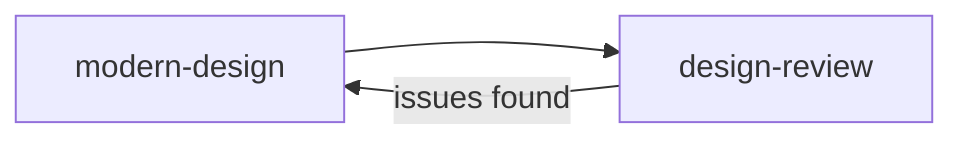

# Architecture

> In progress (v0.1.0, unreleased). This describes the design; `docs/ROADMAP.md` says which parts have content.

## Skill flow

Two skills. `modern-design` builds, `design-review` checks. Each one keeps its detail in `references/` files that are loaded only for the step that needs them, so a request that touches only colors does not load the motion guidance.

| Skill | Steps | Reference loaded per step |
|---|---|---|
| modern-design | Start of every run: the shared core, read whole | `references/ethics.md`, `references/content-truth.md`, `references/reasoning.md`, `references/evidence.md` (see "Shared core") |
| | 1. Direction: context, live references, central promise, design brief | `references/direction.md`, then `references/design-reasoning.md` before writing the brief |
| | After reasoning: only the file of each page type in the brief, then principles when needed | `references/pages/<group>.md` (commerce is split in two: `commerce-purchase.md` and `commerce-after-purchase.md`), `references/principles.md` (`references/reasoning-examples.md` for worked examples) |
| | Pages with prices, consent, subscriptions, scarcity, urgency or reviews (hard limit) | `references/ethics.md` |
| | Every build: no invention, placeholders, `content-needed.md` (hard limit, same level as ethics) | `references/content-truth.md` |
| | 2. Tokens: tiers, method against convergence, mandatory tokens, format; then color, dark theme, type and space as needed | `references/tokens.md`, then only the files needed: `references/tokens-color.md`, `references/tokens-color-dark.md`, `references/tokens-type.md`, `references/tokens-space.md` |
| | 3. Components: sections and components in the project's stack, for phone, tablet and desktop | `references/sections/index.md`, one file per section built, `references/responsive.md` |
| | 4. Motion: purposeful animation and interaction | `references/motion.md` |
| | 5. Hand off to design-review | none |
| | Steps 1 and 3: static or app, rendering per route, kinds of state, reuse layers, performance, accessibility, legal minimum | `references/implementation.md` (and the "Implementation" subsection of each `pages/` entry) |
| | Any step that needs an external resource | `references/resources.md` |
| design-review (both modes) | Start of every run: the shared method and evidence rules, read whole when they exist | `../modern-design/references/reasoning.md`, `../modern-design/references/evidence.md` |
| design-review: own project | 1. Review code and design decisions for generic patterns and mistakes | `references/unslop-checklist.md`, `references/copy-states-checklist.md`, `references/mobile-checklist.md`, `references/outdated-checklist.md`; `references/dark-patterns-checklist.md` when the page shows prices, offers, free trials, subscriptions, a sign-up, a payment, consent or cookies, stock or scarcity, urgency or deadlines, reviews or testimonials, or sponsored content |
| | 2. Browser check with screenshots, when the app is running | `references/visual-qa.md` |
| | 3. Fix, or send back to the modern-design step that owns the problem | none |
| design-review: URL audit | 1. Screenshots at 375, 768, 1440 px, HTML read, Lighthouse if Chrome is available | none |
| | 2. Review against the checklists and browser criteria | `references/unslop-checklist.md`, `references/copy-states-checklist.md`, `references/mobile-checklist.md`, `references/outdated-checklist.md`, `references/visual-qa.md`; `references/dark-patterns-checklist.md` when the page shows prices, offers, free trials, subscriptions, a sign-up, a payment, consent or cookies, stock or scarcity, urgency or deadlines, reviews or testimonials, or sponsored content |
| | 3. Write the report | `references/audit-report.md` |

Nothing outside the plugin: installed plugins are copied to a cache, and files outside the plugin are not available. Skills may read each other's files inside the plugin (`design-review` reads `modern-design`'s section references when they exist) and must keep working when they don't.

Order of authority, the same in both skills: ethics (`ethics.md` and `content-truth.md`, hard limits) > `site-decisions.md` (what exists and what the user decided) > `design-brief.md` > `reasoning.md` and `design-reasoning.md` (method for writing the brief) > the other references (`principles.md`, `pages/`, `sections/`, `implementation.md` and the rest, consulted afterwards). A user decision that breaks either hard limit is declined with the reason. `design-review` checks the hard limit through its DP family and reads `ethics.md` when it exists.

A skill is split into more skills only when its `SKILL.md` grows past ~500 lines or it triggers badly in tests.

## Project files

`modern-design` writes three files in the root of the user's project, and `design-review` reads them when they exist:

| File | Holds | Rank |
|---|---|---|
| `site-decisions.md` | Current standards (pointing to the tokens in the code, never copying values), the inventory of pages, sections and components, and the user's own decisions with the guideline each overrides. Read at the start of every run and updated after every step. Never named `design.md`, which collides with Impeccable's `DESIGN.md` on case-insensitive file systems. | Above the brief, below `ethics.md` |
| `design-brief.md` | The direction the model proposed: context, central promise, design assumptions, references, structure, direction. | Below `site-decisions.md` |
| `content-needed.md` | Every placeholder: what is missing, where it goes, the placeholder used, the model's guess (only here, marked "assumption: confirm") and its status. | Not a rule; a list of what blocks publishing |

Templates for the first and third are in `modern-design/references/templates/`; the brief's template is in `direction.md`. The skills never write `PRODUCT.md` or `DESIGN.md`.

**No invention.** `content-truth.md` is a hard limit: the model never invents or assumes prices, figures, business texts, reviews, testimonials, hours, addresses, footer legal details or photos, and declines when the user asks. Missing content is built as a marked placeholder (`data-placeholder`, `[FIELD]`, lorem ipsum, labelled image boxes); a planned section without data keeps its placeholders until the user decides to drop it. `design-review` reports every placeholder as `measured` and blocking under "Before publishing".

## Levels

The design references are organised in four levels, from the smallest piece to the whole page:

| Level | What it decides | Where | Status |
|---|---|---|---|
| Tokens | Three tiers (base values → semantic roles → component tokens; components read roles, themes remap only the semantic tier); color, dark theme, type, spacing, radii, elevation, targets, focus; motion names reserved | `references/tokens.md` (the step), `tokens-color.md`, `tokens-color-dark.md`, `tokens-type.md`, `tokens-space.md` | Written (3c); motion values pending in `motion.md` |
| Components | Reusable pieces shared by several sections: buttons, cards, inputs, badges | `references/components/` | Pending (3b, batch D) |
| Sections | Whole page sections with phone, tablet and desktop layouts | `references/sections/`, `references/responsive.md` | Batch A written |
| Pages | Per page type: the user's moment, what the page must prove, levers, specifics, when the usual advice flips, persuasion dial | `references/pages/` | Reasoning written; "Layout & responsive" per page type pending |

Above the levels sits the reasoning layer (the shared core described below, plus `design-reasoning.md` and `principles.md`), which decides which pages and sections exist before any level is built. Beside them, `implementation.md` decides how each level is built: rendering per route, state, the same four levels as reuse layers, performance, accessibility and the legal minimum. Backend security is out of scope (its "Boundaries" section).

## Shared core

Five pieces apply to every skill, whatever it builds or reviews. They live in `modern-design/references/`, because installed plugins are copied whole to a cache and a folder without a `SKILL.md` has not been checked with `claude plugin validate`.

| File | Holds | Read by |
|---|---|---|
| `ethics.md` | Hard limit: legitimate persuasion versus dark patterns, real cases, dated regulatory status, blacklist, quality of popular claims, minimum per page type | `modern-design`: whole, at the start of every run. `design-review`: for the cases behind its DP family |
| `content-truth.md` | Hard limit: no invention, the three sources of every text, placeholders, `content-needed.md` | `modern-design`: whole, at the start of every run |
| `reasoning.md` | The shared method: think instead of filling in, the central promise, the four mechanisms, the persuasion dial scale, collisions between principles | Both skills: whole, at the start of every run |
| `evidence.md` | Evidence grades A, B and C; what counts as verified (primary source, date checked, dated status, secondary sources as context, unverified claims marked); how to cite | Both skills: whole, at the start of every run |
| `templates/site-decisions.md`, `templates/content-needed.md` | Templates of the project files | Whichever skill creates the file first |

The page-design part of the method is not shared: `design-reasoning.md` (six questions per screen, worked examples, which reference to open, how to present design work) and `principles.md` belong to `modern-design`.

**How other skills read it.** A skill other than `modern-design` names each core file by `${CLAUDE_SKILL_DIR}/../modern-design/references/<file>`, the pattern `design-review` already uses, and keeps working when the file is missing: its own `SKILL.md` carries the rules it needs in short form. The skill scanner reports these paths as `reference_missing`, which doesn't block the scan.

**Standard form.** Core files carry the fixed header described below, with **Owner:** "shared core (lives in modern-design)", and write decision rules in the Rule / Why / When it flips / Source form. The order of authority is the same everywhere: ethics (`ethics.md` and `content-truth.md`) > `site-decisions.md` > `design-brief.md` > `reasoning.md` and `design-reasoning.md` > the other references.

## How new references are written

From the tokens files on, references use a fixed header and a fixed rule form, so the model can reason about each rule instead of ticking it.

**Header**, five lines in a quote at the top: **Covers** (what the file decides), **Read when** (step or situation), **Not here** (topic → the file that has it), **Owner** (the skill), **Sources** (short list, with the full table in `docs/research/`).

**Rule form:**

- **Rule:** "do X when Y". MUST only for accessibility, security, legal requirements and the truth rule; everything else SHOULD.
- **Why:** the mechanism, tied to a concept of `reasoning.md` when there is one (central promise, attention, trust, deciding, memory, persuasion dial).
- **When it flips:** the context where the usual rule stops working, and what to do then.
- **Source:** a short credit ("adapted from <repo> (<licence>)"; "changes made" for CC BY).

Trivial rules may fit on one line; decision rules always carry Why and When it flips. Older references move to this form when they are next revised.

## Context over rules

Design rules that hold everywhere are rare. A pill badge, a gradient or an italic serif word is a tired cliché in one product and the right choice in another. So:

- Rules are written as "do X when Y", never as absolute bans.
- The user's decisions in `site-decisions.md`, then the design brief from the direction step, are the tie-breakers. When a rule and either of them disagree, they win and the reason is stated.
- `ethics.md` and `content-truth.md` stay above both: a decision that deceives, or invents content, is declined. Measured failures (contrast, accessibility) are still reported when the user decided them, marked "decided by user".
- `design-review` flags patterns as likely generic in this context, not as forbidden.

## URL audit mode

`design-review` can also audit any public site, not only the user's own project. The audit is read-only (no forms, no logins, no changes), covers public pages only, and stops at three pages. It returns a report in the user's language, saved as `audits/<domain>-<YYYY-MM-DD>.md` with screenshots in a folder of the same name.

Each finding in the report is tagged `measured` (Lighthouse or code) or `judgment` (design criteria). "Outdated" findings are almost always judgment, and the report says so, so a reader can tell a measured problem from a matter of taste.

## How the direction step researches references

1. **Find** with WebSearch: look for live sites in the same category, audience and tone as the project, on galleries such as Awwwards and Curated and on real product sites.
2. **Read** with WebFetch: take text, structure and copy patterns from the pages found.
3. **See** with Playwright screenshots: capture what text cannot describe, such as layout, density, type scale, color and motion.
4. **Extract principles, never clone.** The brief records what makes each reference work (for example "large type, one accent color, dense product screenshots") and never its code, assets or copy.

The brief lists every reference URL so the user can see where the direction came from.
