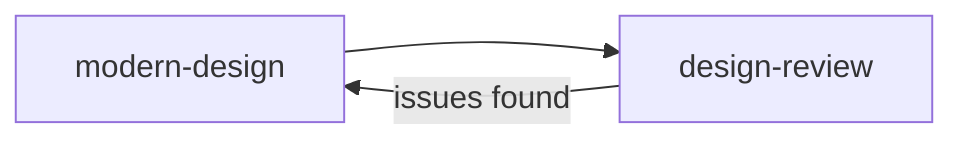

# Architecture

> Skeleton (v0.1.0). This describes the intended design. The skills are still empty.

## Skill flow

Two skills. `modern-design` builds, `design-review` checks. Each one keeps its detail in `references/` files that are loaded only for the step that needs them, so a request that touches only colors does not load the motion guidance.

| Skill | Steps | Reference loaded per step |
|---|---|---|
| modern-design | 1. Direction: context, live references, central promise, design brief | `references/direction.md`, then `references/reasoning.md` before writing the brief |
| | After reasoning: only the file of each page type in the brief, then principles when needed | `references/pages/<group>.md`, `references/principles.md` (`references/reasoning-examples.md` for worked examples) |
| | Pages with prices, consent, subscriptions, scarcity, urgency or reviews (hard limit) | `references/ethics.md` |
| | 2. Tokens: color, type, spacing, radii, shadows, themes | `references/tokens.md` |
| | 3. Components: sections and components in the project's stack, for phone, tablet and desktop | `references/sections/index.md`, one file per section built, `references/responsive.md` |
| | 4. Motion: purposeful animation and interaction | `references/motion.md` |
| | 5. Hand off to design-review | none |
| | Any step that needs an external resource | `references/resources.md` |
| design-review: own project | 1. Review code and design decisions for generic patterns and mistakes | `references/unslop-checklist.md` |
| | 2. Browser check with screenshots, when the app is running | `references/visual-qa.md` |
| | 3. Fix, or send back to the modern-design step that owns the problem | none |
| design-review: URL audit | 1. Screenshots at 375, 768, 1440 px, HTML read, Lighthouse if Chrome is available | none |
| | 2. Review against the checklist and browser criteria | `references/unslop-checklist.md`, `references/visual-qa.md` |
| | 3. Write the report | `references/audit-report.md` |

Nothing outside the plugin: installed plugins are copied to a cache, and files outside the plugin are not available. Skills may read each other's files inside the plugin (`design-review` reads `modern-design`'s section references when they exist) and must keep working when they don't.

Order of authority, the same in both skills: `ethics.md` (hard limit) > `design-brief.md` > `reasoning.md` (method for writing the brief) > `principles.md` and `pages/` (consulted afterwards). `design-review` checks the hard limit through its DP family and reads `ethics.md` when it exists.

A skill is split into more skills only when its `SKILL.md` grows past ~500 lines or it triggers badly in tests.

## Levels

The design references are organised in four levels, from the smallest piece to the whole page:

| Level | What it decides | Where | Status |
|---|---|---|---|
| Tokens | Color, type, spacing, radii, shadows, themes | `references/tokens.md` | Pending (3c) |
| Components | Reusable pieces shared by several sections: buttons, cards, inputs, badges | `references/components/` | Pending (3b, batch D) |
| Sections | Whole page sections with phone, tablet and desktop layouts | `references/sections/`, `references/responsive.md` | Batch A written |
| Pages | Per page type: the user's moment, what the page must prove, levers, specifics, when the usual advice flips, persuasion dial | `references/pages/` | Reasoning written; "Layout & responsive" per page type pending |

Above the levels sits the reasoning layer (`reasoning.md`, `principles.md`, `ethics.md`), which decides which pages and sections exist before any level is built.

## Context over rules

Design rules that hold everywhere are rare. A pill badge, a gradient or an italic serif word is a tired cliché in one product and the right choice in another. So:

- Rules are written as "do X when Y", never as absolute bans.
- The design brief from the direction step is the tie-breaker. When a rule and the brief disagree, the brief wins and the reason is stated.
- `design-review` flags patterns as likely generic in this context, not as forbidden.

## URL audit mode

`design-review` can also audit any public site, not only the user's own project. The audit is read-only (no forms, no logins, no changes), covers public pages only, and stops at three pages. It returns a report in the user's language, saved as `audits/<domain>-<YYYY-MM-DD>.md` with screenshots in a folder of the same name.

Each finding in the report is tagged `measured` (Lighthouse or code) or `judgment` (design criteria). "Outdated" findings are almost always judgment, and the report says so, so a reader can tell a measured problem from a matter of taste.

## How the direction step researches references

1. **Find** with WebSearch: look for live sites in the same category, audience and tone as the project, on galleries such as Awwwards and Curated and on real product sites.
2. **Read** with WebFetch: take text, structure and copy patterns from the pages found.
3. **See** with Playwright screenshots: capture what text cannot describe, such as layout, density, type scale, color and motion.
4. **Extract principles, never clone.** The brief records what makes each reference work (for example "large type, one accent color, dense product screenshots") and never its code, assets or copy.

The brief lists every reference URL so the user can see where the direction came from.
