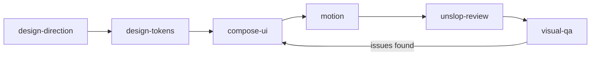

# Architecture

> Skeleton (v0.1.0). This describes the intended design. The skills are still empty.

## Skill flow

Six skills, each with one job. They run in order on a new interface. Each skill can also be called on its own when the task only needs that step.

| Skill | Input | Output |
|---|---|---|
| design-direction | User request, project files, live web references | Design brief |
| design-tokens | Design brief | Color, type, spacing, radius, shadow and theme tokens |
| compose-ui | Brief and tokens | Sections and components in the project's stack |
| motion | Built UI | Purposeful animation and interaction |
| unslop-review | Built UI | List of generic patterns found, and fixes applied |
| visual-qa | Running app | Screenshots and an issue list, sent back to compose-ui when needed |

Each skill is self-contained. It reads only its own `SKILL.md` and `references/` folder, and never paths outside its folder, because installed plugins are copied to a cache and files outside the plugin are not available.

## Context over rules

Design rules that hold everywhere are rare. A pill badge, a gradient or an italic serif word is a tired cliché in one product and the right choice in another. So:

- Rules are written as "do X when Y", never as absolute bans.
- The design brief from `design-direction` is the tie-breaker. When a rule and the brief disagree, the brief wins and the reason is stated.
- `unslop-review` flags patterns as likely generic in this context, not as forbidden.

## How design-direction researches references

1. **Find** with WebSearch: look for live sites in the same category, audience and tone as the project, on galleries such as Awwwards and Curated and on real product sites.
2. **Read** with WebFetch: take text, structure and copy patterns from the pages found.
3. **See** with Playwright screenshots: capture what text cannot describe, such as layout, density, type scale, color and motion.
4. **Extract principles, never clone.** The brief records what makes each reference work (for example "large type, one accent color, dense product screenshots") and never its code, assets or copy.

The brief lists every reference URL so the user can see where the direction came from.
