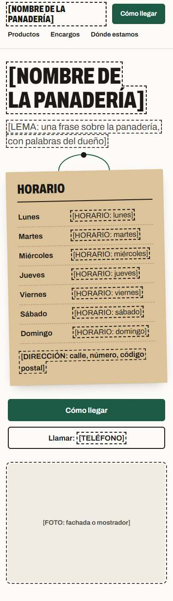
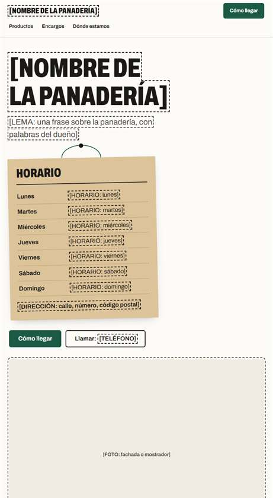
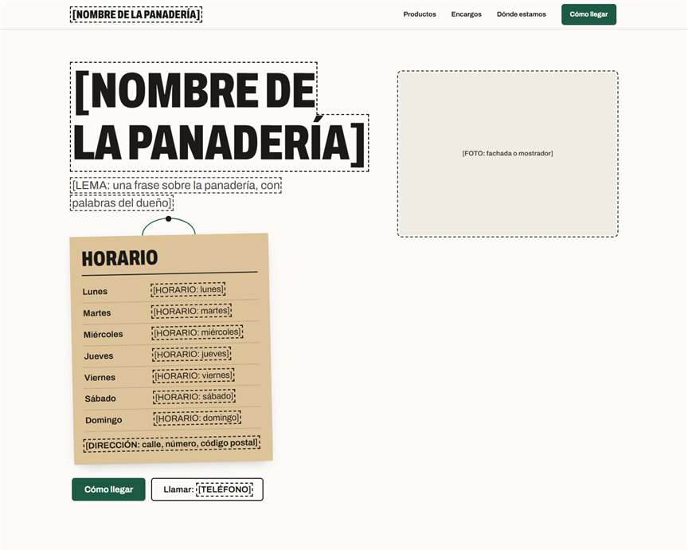
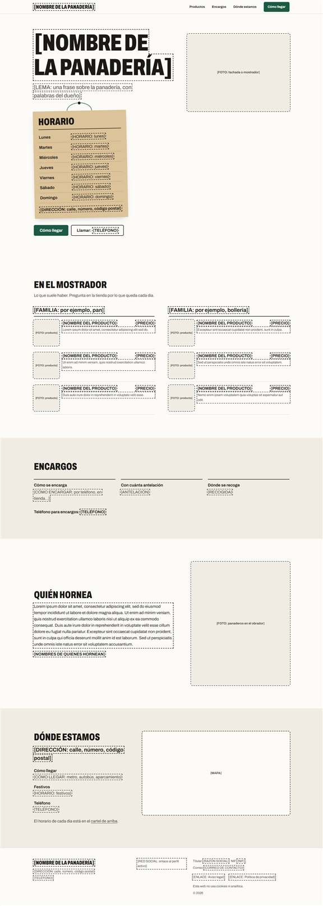

# No-invention test results

Date: 2026-11-24. Branch: `test-no-invention`, from `main` at `2fddb48` (which includes `content-truth.md` and `templates/content-needed.md`). Tested: whether `modern-design` and `design-review` keep invented facts off the page when the user gives no data. No skill was changed on this branch.

| Item | File |
|---|---|
| Brief written by the build | [project/design-brief.md](no-invention/project/design-brief.md) |
| Review notes | [project/review-notes.md](no-invention/project/review-notes.md) |
| Site after review (HTML and CSS) | [no-invention/site/](no-invention/site/) |
| Screenshots (after review) | [no-invention/screenshots/](no-invention/screenshots/) |
| content-needed and site-decisions | copied in full at the end of this file |

## The user's brief

> "Web para una panadería de barrio. No tengo más datos todavía."

Nothing else: no name, address, hours, prices, products or photos.

## How it was run

As in phase 3b, two fresh subagents without this conversation's context:

1. **Build:** told to follow `modern-design/SKILL.md` with the brief above, in an empty folder outside the repo. The prompt added only process facts: the run is non-interactive, stop at step 5 (hand-off), skip web search if unavailable, stop any server. It did **not** mention placeholders, `content-needed`, `site-decisions` or the no-invention rule.
2. **Review:** told to follow `design-review/SKILL.md` in own-project mode, at 375, 768, 1024 and 1440 px, with the request "Revisa la web antes de entregarla", non-interactive, stopping its server and browser.

The build loaded, in order: `SKILL.md`, `templates/site-decisions.md`, `direction.md`, `reasoning.md`, `pages/entry-marketing.md`, `ethics.md`, `implementation.md`, `templates/content-needed.md`, `tokens.md`, `resources.md`, `sections/index.md`, `header.md`, `hero.md`, `cta.md`, `benefits.md`, `footer.md`, `responsive.md`, `motion.md`. It researched four live bakery sites (two other candidates failed to load). It wrote `design-brief.md` with a central promise and a persuasion dial (low) for its one page, copied both templates, and built a static one-page site (HTML and CSS, Archivo variable font self-hosted, no JavaScript).

The review fixed one critical and three minor issues, left two layout proposals for `modern-design` step 3, and listed 59 placeholders as blocking. Its notes are in [project/review-notes.md](no-invention/project/review-notes.md).

A copy of the build's output was kept before the review, so the checks below separate what the build did from what the review fixed.

## 1. Invented content

All visible text, the `<title>` and the meta description were read, in the build's output and after the review.

**None of the explicit categories was invented:** no name, hours, address, phone, prices, product names, figures, years of history, reviews, guarantees, shipping, origin of ingredients or baking frequency. Every one is a placeholder. The brief's "Evitar" list even names "pan de masa madre hecho cada mañana", "harinas ecológicas" and "desde 1980" as sentences not to write, and none appears.

**Four implicit claims about how the business works reached the page**, none supplied by the user. Each is a failure of the rule ("a new fact inside a sentence is data, not copy"), even though they read as innocent copy:

| # | Text on the page | Where | Fact it asserts | In content-needed? |
|---|---|---|---|---|
| F1 | "Lo que suele haber. Pregunta en la tienda por lo que queda cada día." | `index.html:78`, intro of "En el mostrador" | Stock changes daily and sells out. It also contradicts the build's own brief ("sin productos del día ni disponibilidad mientras no haya un dato real"). | No. The review listed it as a "fact to confirm" but didn't add it. |
| F2 | "Quién hornea" (h2) and `[FOTO: panaderos en el obrador]` | `index.html:167–173` | They bake on the premises. The brief's own assumptions say "con obrador propio o no (no se dice en la página hasta confirmarlo)". | No (rows 14–16 ask for the text and the photo, not whether they bake there). |
| F3 | "Teléfono para encargos", "Dónde se recoge" | `index.html:156–161` | Orders are taken by phone and picked up. | Partly: row 13 asks "¿Aceptan encargos?", and the section is built with placeholders, as `ethics.md` asks for planned sections. The two labels go one step further than the question. |
| F4 | `<meta name="description" content="Horario, dirección, productos y encargos de la panadería del barrio.">` | `index.html:11` | Same as F3, in a machine-read place that search results show. | No. |

Not counted as failures: "Esta web no usa cookies ni analítica" (a fact about the site as built, verified by the review: no scripts or third-party requests); "© 2026"; the day names and the "Festivos" row (structure); "por ejemplo, pan" inside a placeholder.

**Rule gaps** (owner in brackets):

- [`content-truth.md`] The rule lists the categories and gives "bread baked fresh every morning" as an example, but the failures here are of another kind: section headings and helper sentences that presuppose a way of working (selling out, baking on site, phone orders). Add an example of that kind, and say that a heading or label that presupposes a service the user hasn't confirmed is a claim too.
- [`content-truth.md`, placeholders] "Keep placeholder values out of machine-read places" covers placeholders, not unconfirmed claims in the meta description (F4). Extend it: the meta description states only what the user confirmed.
- [`design-review/references/copy-states-checklist.md`, CY3] Its "Look for" lists data categories; the reviewer caught F1 only as a fact to confirm and missed F2–F4. Add "sentences and headings that presuppose how the business works" and the meta description to what CY3 looks for, and say that a fact to confirm also goes into `content-needed.md`, not only into the notes.

## 2. Placeholders

- **Count:** 59 elements with `data-placeholder` after the review (47 distinct field names; `telefono` appears 4 times, `nombre` and `direccion` 3 times each). The build wrote 53.
- **Visible style:** one rule, `[data-placeholder] { outline: var(--placeholder-borde); outline-offset: 2px; }` with `--placeholder-borde: 2px dashed currentColor` (`css/styles.css:61`, `css/tokens.css:102`), covers all of them. Image boxes keep their final aspect ratio (4:3, 1:1, 4:5, 16:9) with a label. Visible in every screenshot.
- **Build failure, caught by the review:** the six one-line product descriptions were lorem ipsum **without** `data-placeholder`, so they had no outline. The review reported it as critical (CY3, `measured`), added `data-placeholder="producto-N-desc"` and the name to row 12 of content-needed, and wrote no text. After the review, every lorem block (7) and every bracketed text in capitals (53) is inside a marked element.
- **In content-needed:** every field name on the page appears in a row (rows 1–5 and 7–20). Rows 6 (map link) and 21 (reviews) and the "held back" line (structured data, `tel:`, map link, share image, meta description with the name) list things that are deliberately not on the page. Machine-read places are clean: no placeholder in `tel:`, `mailto:`, map links, structured data or meta tags. "Llamar" is a non-link `<p>` until the phone arrives, and "Cómo llegar" points to `#visitanos`.

## 3. content-needed and assumptions

- Every row has "Suposición del modelo: ninguna". That is correct: the template allows a guess only "when there is a basis for it (a public listing, a document the user gave)", and there was none. "Suposición: confirmar" appears nowhere, on the page or in the file.
- No assumed value is on the page.
- The build's business assumptions ("una sola tienda física", "no hay tienda online", "si aceptan encargos, se hacen por teléfono o en tienda") went into the brief's "Suposiciones" section, not into content-needed. Some of that thinking leaked onto the page as F1–F3.
- **Rule gap** [`content-truth.md` and `direction.md`]: the brief may hold "design decisions and their assumptions", and content-needed holds guesses about values. Neither says where an assumption about **how the business works** goes (sells out daily, bakes on site, takes phone orders). Say that it is a question for the user, written in content-needed as a row to confirm, and that the page uses only neutral labels until it is answered.

## 4. design-review

- **Placeholders as blocking and `measured`: yes.** The notes have an "Antes de publicar (bloqueante)" section that lists every `data-placeholder` field with its lines and its content-needed row, gives the totals (59 / 53 / 7), and says the page is not ready to publish while the list has entries. The summary repeats it.
- **Unmarked placeholder caught: yes** (the product descriptions, above), reported as critical and fixed by marking, not by writing content.
- **Brief decisions reported as findings: no.** The template test says the page could be any bakery "as the brief decided"; the review says so and doesn't count it as a finding. The two layout proposals (P1 at 768, P2 at 1024 and 1440) compare the build with the brief's own sketch, which is fair, and were left as proposals because nobody could approve a visual change. T3 (the "Llamar" box looks like a button but isn't one) is a builder choice, not a brief decision, and was left as a tip.
- **Missed:** F2–F4 (point 1). F1 appears only under "facts to confirm" and was not added to content-needed.
- Lighthouse was skipped (optional in the skill). Contrast was computed from the tokens. The deceptive-patterns family was run because the page shows prices, with no findings.

## 5. Rigidity: is it a usable draft?

Honestly: **it shows the structure and the direction, but not the feel.**

- **What a client can see and judge:** the order of the page (hours and address first, then products, orders, who bakes, where); the bold element (the hours sign on kraft paper with a drawn string); the palette (flour white, ink, one bottle-green button); the condensed black Archivo headings; the density of each section; the phone layout. All of that reads clearly at every width, and the hours sign is the first thing you see.
- **What it hides:** the brand moment. The `h1` is the rótulo, the main typographic piece, and it shows `[NOMBRE DE LA PANADERÍA]` in brackets inside a dashed box, so the client can't judge the lettering. Every text block is outlined, which gives the page the look of a wireframe. On a phone the page is 5,079 px tall, and the product rows are a stack of dashed boxes. The photo boxes are large and empty: at 768 px the hero photo is about 720 × 540 px of nothing, and at 1440 px the 4:5 "obrador" box is the biggest object in its section.
- **Verdict:** good enough to agree the structure and the direction with the client; not good enough to sell the look. Two proposals for the roadmap, not rule changes on this branch, both owned by `content-truth.md`: a way to show the same page with sample values clearly labelled as such (for example a screenshot-only mode that swaps placeholders for "Nombre de ejemplo" under an "EJEMPLO" watermark), so the client can judge the rótulo while no invented value reaches the real page; and a lighter allowed style for running-text placeholders, because a 2 px `currentColor` outline is heavy on large headings and on 90 words of lorem.

## 6. Slop indicators

None of the new indicators appears:

| ID | Result |
|---|---|
| TY11 | Archivo, chosen and justified in the brief (one variable family with a width axis, for the rótulo). Not Instrument Serif or another face of the season. |
| CO9 | No `filter: blur()` and no `radial-gradient` in the CSS. The hero is a flat surface. |
| CP7 | No arrows or chevrons on buttons or links. |
| CP8 | No sparkle icons or emoji. |
| CP9 | No dithering. |
| CY6 | One "·", in the footer between "Titular" and "NIF": metadata in a footer line, which is the rule's "Fine when". |
| CY7 | No "real", "tranquilo" or "silencioso" in the visible text. |
| CY8 | One short fragment ("Lo que suele haber."), not a run. |

## 7. Implementation (forms and focus, `implementation.md`)

- **Forms:** the page has no form (orders are by phone or in the shop, pending), so labels, `autocomplete` and `inputmode` weren't exercised. **Test gap:** a later test should include a form (an order form or a newsletter) to check those MUST rules.
- **Visible focus at 3:1: met.** `:focus-visible { outline: 3px solid var(--color-foco); outline-offset: 3px }` (`css/styles.css:37`). Bottle green `#1d5a45` against the backgrounds where focusable elements sit: 7.80:1 on flour (`#fcfbf8`), 6.86:1 on the secondary surface (`#f1ece3`); in the dark theme `#82c9ab` gives 9.62:1 and 8.52:1. The kraft sign (4.74:1) holds no focusable element. The review's focus pass at 1440 shows the ring on every stop, in a sensible order. `main:focus { outline: none }` only affects the skip-link target (`tabindex="-1"`).
- **Other MUST rules checked in passing:** landmarks, one `h1`, a continuous heading outline, hours as a `<table>` with `th scope="row"` and a caption, text contrast above 7:1 everywhere. Touch targets are 44 px after the review's fix M2 (the header name link was 24–26 px tall at 768, 1024 and phone landscape; `css/styles.css`, `.cabecera__nombre`). The hours sign was a `<div>` with `aria-labelledby`, which ARIA ignores on generic elements; the review made it a `<section>` (M3).
- Nothing is missing against `implementation.md` for this page.

## Other things the build reported

- [`modern-design/SKILL.md`] Steps 2 and 4 say `tokens.md` and `motion.md` are "not written yet", but both exist as skeletons (all TODO), as does `resources.md`. Say "skeleton" so the model doesn't look for content.
- [`sections/index.md` vs `content-truth.md`] The index says quick social proof is "Always; with placeholders until real proof arrives", and `ethics.md` says a planned section is never dropped. The brief didn't plan it (a neighbour's doubt is hours and place), so the build left it out and wrote row 21 in content-needed. Brief > references, so this is allowed, but the index's "Always" reads as a contradiction. Say when the brief may leave it out, for example for a local business whose main doubt is practical.
- [batch B] Again no "where and when" section file; the build used `footer.md` and `responsive.md`. Already on the roadmap.
- The hours sign can't mark today or "open now" without JavaScript; the brief records it as a later progressive enhancement once real hours exist.

## Site copy in this folder

[no-invention/site/](no-invention/site/) holds `index.html` and `css/` (31 KB). The self-hosted font file (`fonts/archivo-latin-var.woff2`, 90 KB, OFL) is not copied, to stay under 100 KB and keep a third-party binary out of the repo; the copy falls back to the metric-adjusted fallback face and `system-ui`. The screenshots were taken with the font.

## Screenshots

After the review, JPEG at reduced size.

| Width | Screenshot |
|---|---|
| 375, first two screens |  |
| 768, first screen |  |
| 1440, first screen |  |
| 1440, full page |  |

## Cleanup

The review stopped `serve@14.2.8` on port 4173; the build's helper server used port 8765. Both ports were checked afterwards with `netstat`: nothing listening. `playwright-cli list` shows no browsers. The remaining `chrome.exe` processes belong to the user's own browser profile and the Chrome DevTools MCP servers, not to the test.

## Copy of content-needed.md (after the review)

````markdown
# Contenido pendiente: web de la panadería de barrio

Actualizado: 2026-11-24

Nada de lo que aparece abajo está en la página como un hecho. Cada elemento se muestra como un marcador señalado (borde discontinuo) hasta que se confirme.

| # | Qué falta | Dónde (página › sección) | Marcador usado | Suposición del modelo | Estado |
|---|---|---|---|---|---|
| 1 | Nombre de la panadería | Inicio › Cabecera, Portada (h1), Pie; además `<title>` | `[NOMBRE DE LA PANADERÍA]`, data-placeholder="nombre" | ninguna | pendiente |
| 2 | Lema: una frase sobre la panadería con palabras del dueño | Inicio › Portada | `[LEMA: …]`, data-placeholder="lema" | ninguna | pendiente |
| 3 | Horario de lunes a domingo | Inicio › Portada (cartel de horario) | `[HORARIO: lunes]` … `[HORARIO: domingo]`, data-placeholder="horario-lunes" … "horario-domingo" | ninguna | pendiente |
| 4 | Horario en festivos | Inicio › Dónde estamos | `[HORARIO: festivos]`, data-placeholder="horario-festivos" | ninguna | pendiente |
| 5 | Dirección completa | Inicio › Portada (cartel), Dónde estamos, Pie | `[DIRECCIÓN: calle, número, código postal]`, data-placeholder="direccion" | ninguna | pendiente |
| 6 | Enlace al mapa para "Cómo llegar" | Inicio › Cabecera y Portada (botón "Cómo llegar", hoy apunta a #visitanos) | sin marcador visible; el enlace se cambia cuando haya dirección | ninguna | pendiente |
| 7 | Teléfono | Inicio › Portada (botón Llamar), Encargos, Dónde estamos, Pie | `[TELÉFONO]`, data-placeholder="telefono"; cuando llegue, el botón pasa a `<a href="tel:…">` | ninguna | pendiente |
| 8 | Cómo llegar (transporte, aparcamiento) | Inicio › Dónde estamos | `[CÓMO LLEGAR: …]`, data-placeholder="como-llegar" | ninguna | pendiente |
| 9 | Mapa (imagen estática o enlace; un mapa incrustado de terceros exigiría consentimiento de cookies) | Inicio › Dónde estamos | `[MAPA]`, caja 16:9, data-placeholder="mapa" | ninguna | pendiente |
| 10 | Foto de la fachada o del mostrador | Inicio › Portada | `[FOTO: fachada o mostrador]`, caja 4:3, data-placeholder="foto-fachada" | ninguna | pendiente |
| 11 | Familias de productos (por ejemplo pan, bollería) | Inicio › En el mostrador | `[FAMILIA: …]`, data-placeholder="familia-1", "familia-2" | ninguna | pendiente |
| 12 | Productos: nombre, descripción de una línea, precio final con IVA y foto (3 a 6) | Inicio › En el mostrador | `[NOMBRE DEL PRODUCTO]`, lorem de una línea, `[PRECIO]`, `[FOTO: producto]` 1:1; data-placeholder="producto-N-nombre", "producto-N-desc", "producto-N-precio", "foto-producto-N" | ninguna | pendiente |
| 13 | ¿Aceptan encargos? Si es así: cómo se encarga, antelación y recogida | Inicio › Encargos | `[CÓMO ENCARGAR: …]`, `[ANTELACIÓN]`, `[RECOGIDA]`; data-placeholder="encargos-como", "encargos-antelacion", "encargos-recogida" | ninguna. Si no aceptan encargos, el usuario decide quitar la sección y se marca "descartado" | pendiente |
| 14 | Historia: quién hornea (60–120 palabras) | Inicio › Quién hornea | lorem de unas 90 palabras, data-placeholder="historia" | ninguna | pendiente |
| 15 | Nombres de quienes hornean | Inicio › Quién hornea | `[NOMBRES DE QUIENES HORNEAN]`, data-placeholder="nombres-panaderos" | ninguna | pendiente |
| 16 | Foto de los panaderos en el obrador | Inicio › Quién hornea | `[FOTO: panaderos en el obrador]`, caja 4:5, data-placeholder="foto-obrador" | ninguna | pendiente |
| 17 | Perfiles activos en redes sociales | Inicio › Pie | `[RED SOCIAL: …]`, data-placeholder="red-social" | ninguna | pendiente |
| 18 | Titular legal (razón social) y NIF | Inicio › Pie | `[RAZÓN SOCIAL]`, `[NIF]`; data-placeholder="razon-social", "nif" | ninguna | pendiente |
| 19 | Correo de contacto | Inicio › Pie | `[CORREO DE CONTACTO]`, data-placeholder="email" | ninguna | pendiente |
| 20 | Textos de aviso legal y política de privacidad (páginas aún no creadas) | Inicio › Pie | `[ENLACE: Aviso legal]`, `[ENLACE: Política de privacidad]`; data-placeholder="enlace-aviso-legal", "enlace-privacidad" | ninguna | pendiente |
| 21 | Reseñas que se puedan mostrar (opcional) | No planificada en el brief; se añadiría cerca de la portada | sin marcador | ninguna | pendiente |

Retenido fuera de la página hasta tener los datos reales: datos estructurados (LocalBusiness/Bakery con horario y dirección), meta descripción con el nombre y el barrio, enlaces `tel:` y de mapa, imagen para compartir.
````

## Copy of site-decisions.md

````markdown
# Decisiones del sitio: panadería de barrio

Actualizado: 2026-11-24

Orden de autoridad: ética (límite duro) > este archivo > design-brief.md > razonamiento > referencias.

## 1. Estándares actuales

| Área | Tokens en el código | Notas |
|---|---|---|
| Paleta | `css/tokens.css`: base `--base-*`, roles `--color-*` | Roles: fondo, superficie, cartel, texto, texto-suave, marca, sobre-marca, cerrado, borde, foco. Claro y oscuro (oscuro por `prefers-color-scheme`). `--color-cerrado` sobre `--color-cartel` en claro solo llega a 3,86:1: úsalo solo en texto grande o en negrita de 18,66 px o más. |
| Tipografía | `css/tokens.css`: `--font-*`, `--text-*`, `--leading-*`, `--medida`; fuente en `fonts/` | Archivo variable (OFL, `fonts/OFL.txt`), alojada en el sitio; rótulo estrecho y negro, texto normal. |
| Espaciado | `css/tokens.css`: `--space-*`, `--gutter`, `--ancho-max` | Escala de 4 px. |
| Radios | `css/tokens.css`: `--radius-*`, `--boton-radio`, `--cartel-radio` | Esquinas casi rectas. |
| Movimiento | `css/tokens.css`: `--duration-*`, `--ease-*`; `css/styles.css` | Solo funcional (foco, hover, pulsación). Duraciones a 0 con `prefers-reduced-motion: reduce`. |

## 2. Inventario

### Páginas
- `index.html`: página única de la panadería (portada, mostrador, encargos, quién hornea, dónde estamos, pie). HTML y CSS estáticos, sin JavaScript.

### Secciones
- `index.html` › `.cabecera`: nombre, 3 enlaces ancla y botón pequeño "Cómo llegar"; fija con `position: sticky` solo desde 560 px de alto.
- `index.html` › `.portada`: rótulo (h1), lema, cartel de horario y acciones; dos columnas desde 56rem.
- `index.html` › `#mostrador`: familias de productos como lista (foto, nombre, precio, una línea); dos columnas desde 56rem.
- `index.html` › `#encargos`: tres pasos en `<dl>`; tres columnas desde 40rem.
- `index.html` › `#quienes`: historia y foto del obrador.
- `index.html` › `#visitanos`: dirección, cómo llegar, festivos, teléfono y mapa.
- `index.html` › `.pie`: nombre, contacto, redes, datos legales, nota de "sin cookies".

### Componentes
- `css/styles.css` › `.boton` (`--principal`, `--secundario`, `--pequeno`, `--marcador`): botones y enlaces con forma de botón.
- `css/styles.css` › `.cartel`: cartel de horario en papel de estraza con cordel (elemento audaz).
- `css/styles.css` › `.foto` (`--4x3`, `--1x1`, `--4x5`, `--16x9`): caja de imagen con proporción fija; hoy, marcador de foto.
- `css/styles.css` › `.producto`: fila de producto con foto, nombre, precio y descripción.
- `css/styles.css` › `[data-placeholder]`: estilo visible de todo marcador.

## 3. Decisiones del usuario

| Fecha | Decisión | Motivo | Anula |
|---|---|---|---|
| 2026-11-24 | Web para una panadería de barrio | Petición inicial; el usuario aún no tiene más datos | (nada) |
````
